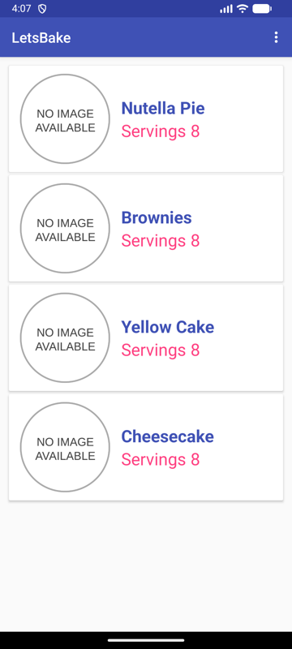
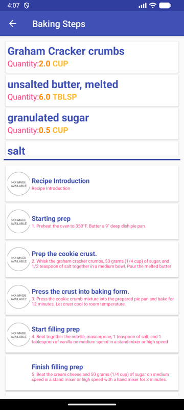
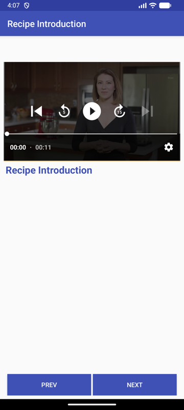

# LetsBake

An Android baking app (originally built in 2017) that lists recipes, shows their ingredients and step-by-step instructions with video playback, and includes a home-screen widget showing a recipe's ingredients.

<p>
  
  
  
</p>

## Features

- Recipe list with card layout (Picasso for images)
- Ingredients and steps per recipe, master/detail fragments for tablets
- Step videos via ExoPlayer
- Home-screen app widget (StackView) for ingredients
- JSON parsing with Gson

## Tech

- Java, AndroidX
- compileSdk/targetSdk 34, minSdk 21
- Gradle 8.9, Android Gradle Plugin 8.7
- ExoPlayer 2.19

Recipe data comes from Udacity's public baking JSON.

## Building

Requires JDK 17+ and the Android SDK (API 34).

```bash
./gradlew installDebug
```

## Status

Archived. The build was upgraded in 2026 (from AGP 2.3 / Support Library) so it still runs on current Android, but the project is not actively maintained.
